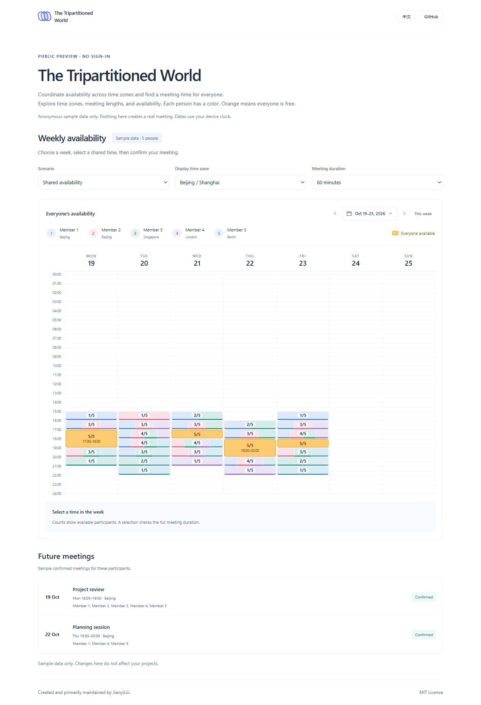
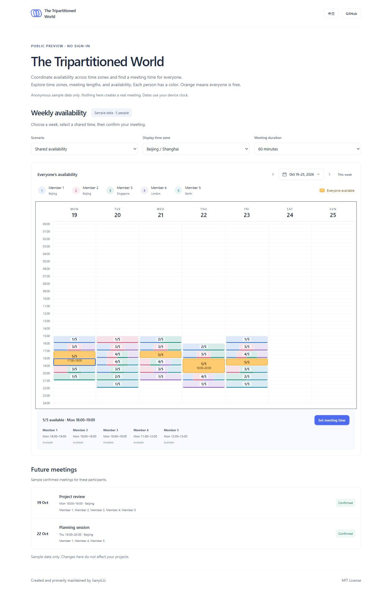
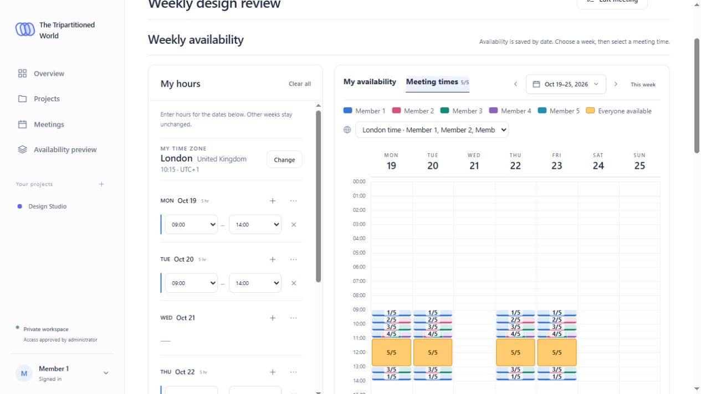
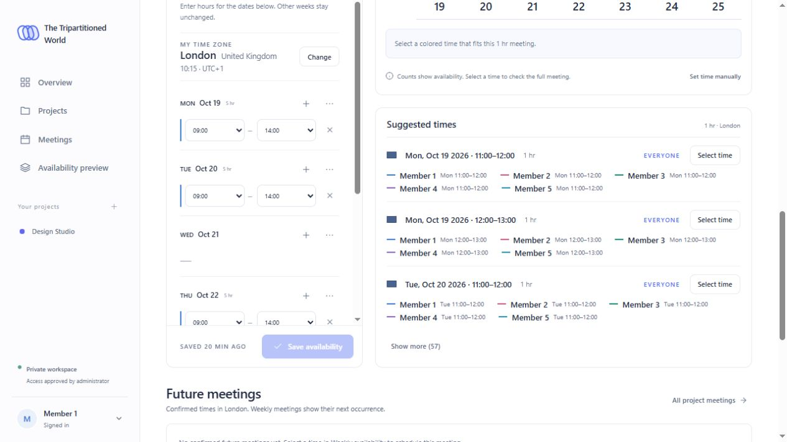
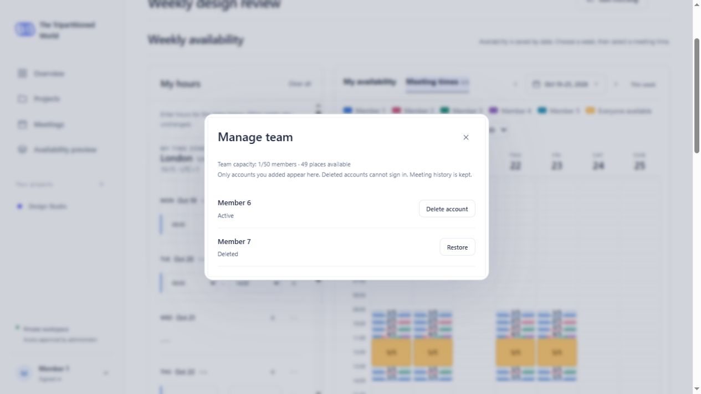

# The Tripartitioned World

### Coordinate availability across time zones and find a meeting time for everyone.

**The Tripartitioned World（三等分的世界）** helps small teams schedule meetings across countries and time zones. Compare each person's available hours, see shared time in orange, and check the proposed meeting in everyone's local time.

Created and primarily maintained by **JianyiLiii**.

Licensed under the [MIT License](LICENSE).



## Try the public preview

The standalone preview requires **no account**. Try different time zones, meeting durations, availability scenarios, and calendar weeks, then select a colored time slot to see each participant's local time.

The preview uses anonymous sample participants only. It does not connect to a live workspace, send API requests, or save meetings. The only saved browser preference is the interface language.

**Preview address after GitHub Pages is enabled:** [JianyiLiii.github.io/The-Tripartitioned-World](https://JianyiLiii.github.io/The-Tripartitioned-World/). See [publishing instructions](PUBLISHING.md) to activate it.



Run just the preview locally, without the application server:

```sh
python -m http.server 8004 --bind 127.0.0.1 --directory docs
```

Open http://localhost:8004. After editing preview sources, rebuild its assets with `python scripts/build_preview.py`.

## Features

- English and Chinese interface with a white background.
- Project membership and meeting invitations.
- Availability saved by calendar date, with a compact week picker.
- A separate color for each person; orange highlights times when everyone is available.
- Suggested times across all saved future dates, ranked by attendance and then time.
- Future meetings, time-zone conversion, and calendar exports.
- Optional approved-account sign-in with six-digit passwords and persistent sessions.
- Each administrator manages a team of up to 50 accounts. Deleting an account releases a place; restoration requires available capacity.
- Only the configured owner can appoint or remove administrators. Ordinary members cannot create accounts.

## Screenshots

All screenshots below use **anonymous sample labels and fictional projects** in an isolated local instance. They do not identify any real user, administrator, or account owner.

### Availability and meeting selection


### Suggested times across future weeks


### Team account management


## Run locally

Python 3.9 or newer is required. No JavaScript build step is needed.

```sh
python -m pip install -r requirements.txt
python server.py
```

Open http://localhost:8000. The default local mode lets you enter a name to create a local profile. A new `data/` directory is created on first run; this folder is private and ignored by Git.

For local approved-account testing:

```sh
python manage_users.py --file config/access-users.json init
python manage_users.py --file config/access-users.json add "Sample Owner" --admin
```

Create a private `.env` file:

```dotenv
AUTH_MODE=restricted
ACCESS_USERS_FILE=config/access-users.json
OWNER_USER_KEY=sample owner
REQUIRE_PASSWORD_CHANGE=0
MAX_USERS=0
```

Restart the server. Sign in as `Sample Owner` with the initial password `123456`; it can be changed in the account menu. `OWNER_USER_KEY` uses the original normalized, case-insensitive account key, so later display-name changes do not transfer ownership.

The owner can create administrators directly or promote existing accounts. Each administrator sees only accounts they created in **Manage team**. Deletion revokes access and existing sessions, preserves meeting history, and releases team capacity. Restoring an account does not revive its old sessions. Names of deleted accounts remain reserved for restoration.

The full application above is separate from the static public preview. Hosting credentials, production configuration, and live user data are not included.

## Tests

```sh
python -m unittest discover -s tests
node --test tests/*.mjs
```

Node.js is only needed to run frontend tests. Runtime dependencies are Python and a modern browser. Python's `tzdata` package supplies time-zone rules on systems without an IANA time-zone database.

## Source layout

- `server.py`: HTTP API, local persistence, authorization, sessions, and scheduling records.
- `access_control.py`: approved-account validation and password hashing.
- `manage_users.py`: local account-list initialization and maintenance.
- `public/`: browser interface, scheduling calculations, styles, and icons.
- `tests/`: API and frontend scheduling regression tests with synthetic data.
- `docs/screenshots/`: screenshots from the isolated sample workspace.
- `preview/`: standalone preview entry point and client-only adapters.
- `scripts/build_preview.py`: explicit allowlist that builds the public demo.
- `docs/index.html` and `docs/assets/`: ready-to-serve static preview.

## Security

The public preview is a static site with no login, database, file uploads, or server-side API. A restrictive Content Security Policy disables network connections from scripts, forms, embedded objects, and remote scripts. All sample text is rendered as text nodes. Read [SECURITY.md](SECURITY.md) for scope and limitations.

## Data boundaries

No real account lists, passwords, password hashes, session keys, databases, backups, logs, hosting addresses, or production screenshots are included. No existing users or meetings are created by this source package. Built-in preview names and test fixtures are fictional. Keep runtime `data/`, private `.env` files, and `config/access-users.json` out of version control.

Owner and administrator are generic application roles, not statements about anyone's real account. `Sample Owner` is a local setup example only. The author's GitHub username is used solely for authorship and license attribution; it is not a configured login or administrator identifier.
